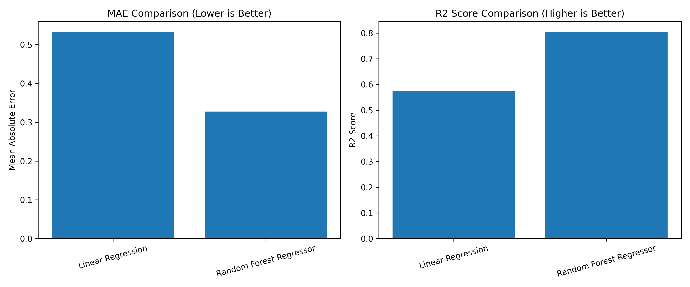

# Real_Estate_Property_Price_Predictor
GetIntern Week-7

## Project Overview
This project predicts median house values using Machine Learning regression algorithms. The California Housing dataset from Scikit-learn is used for model training and evaluation.

## Algorithms Implemented
1. Linear Regression
2. Random Forest Regressor

## Technologies Used
- Python
- Pandas
- NumPy
- Matplotlib
- Scikit-learn
- Google Colab

## Dataset Information
Dataset: California Housing Dataset

- Total records: 20,640
- Input features: 8
- Target variable: MedHouseVal
- Training split: 80%
- Testing split: 20%

The target variable is measured in units of $100,000.

## Model Performance Comparison

| Regression Model | MAE | R² Score |
|---|---:|---:|
| Linear Regression | [Enter result] | [Enter result] |
| Random Forest Regressor | [Enter result] | [Enter result] |

## Model Evaluation
Both models were evaluated using Mean Absolute Error and R² Score on the unseen test dataset.

Lower MAE and higher R² indicate better predictive performance.

## Custom Property Price Prediction

The selected model was used to estimate median house values for three illustrative California housing profiles.

## Regression Metrics Visualization

## Conclusion
This project demonstrates how regression algorithms can be used to estimate housing values. Linear Regression and Random Forest Regressor were trained and compared using standard regression evaluation metrics. Custom property-related inputs were also used to demonstrate model inference.

The final model selection was based on the observed test-set MAE and R² results.
